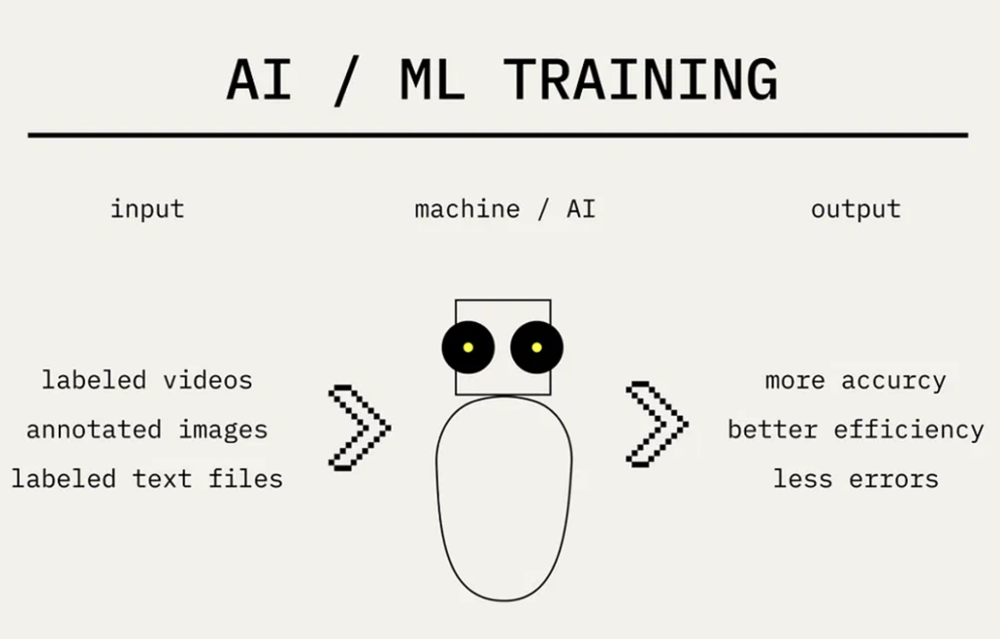
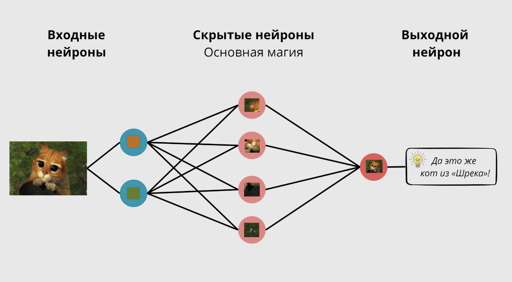
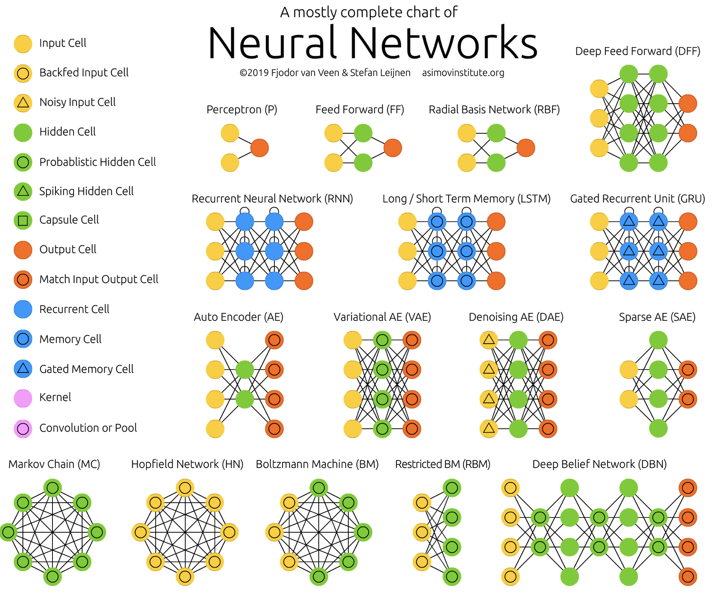
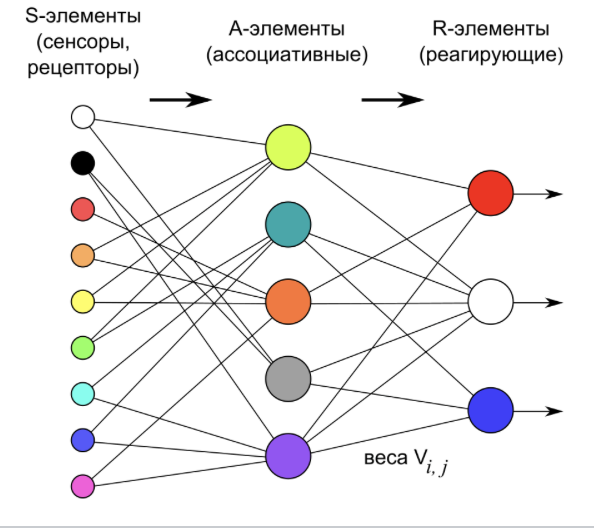
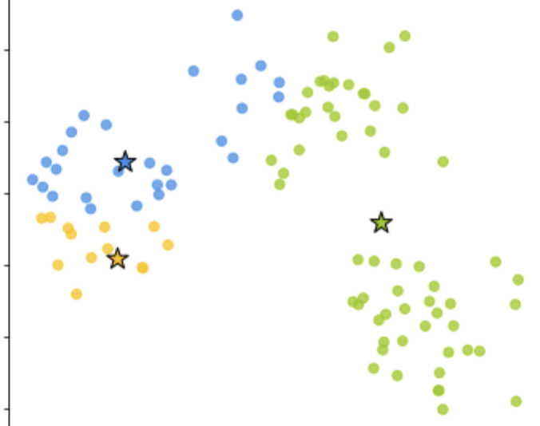
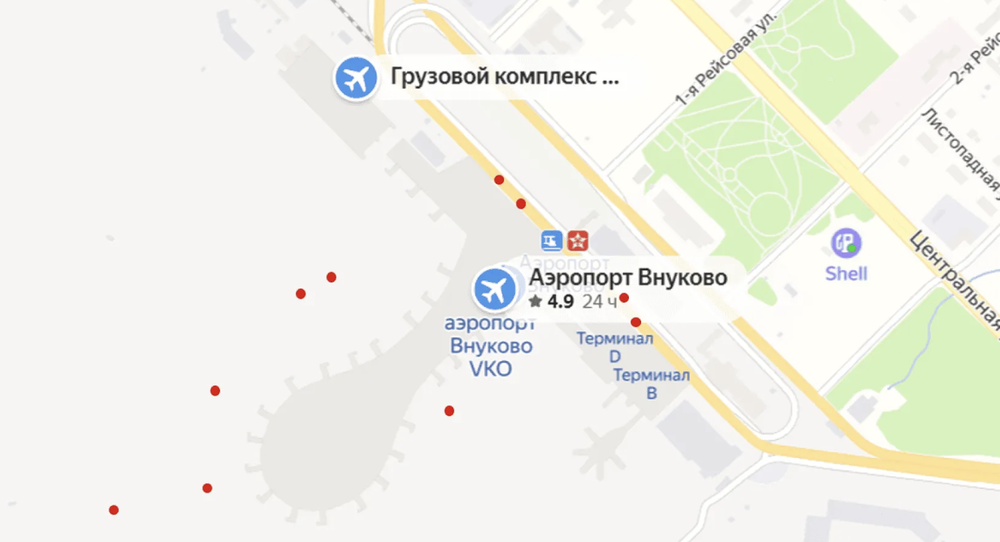
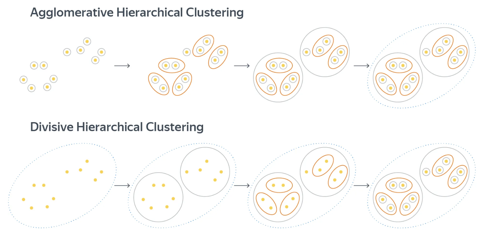
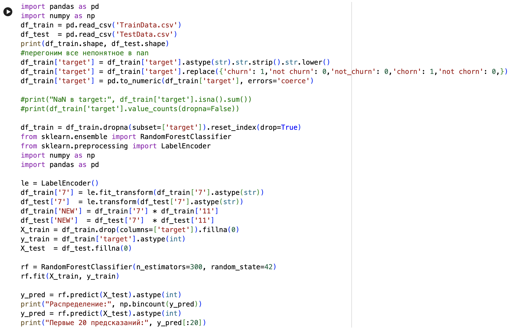
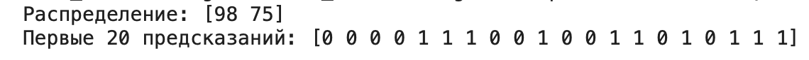
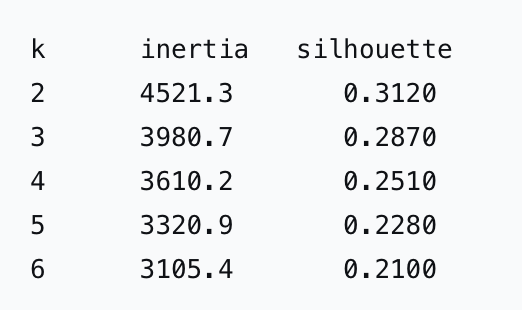

## Перцептрон и кластеризация: два подхода к обучению

### Что такое перцептрон (классификация) и что такое задача кластеризации? А также разбор решения и метрик качества готового датасета.

#### Горбачева Маргарита Валерьевна | 24КНТ4


### ML

Машинное обучение, или ML, или Machine Learning - это способ научить компьютер делать выводы на основе примеров. В рамках этого подхода не пишут чётких правил, а просто показывают компьютеру много похожих ситуаций. Компьютер сам находит в этих примерах закономерности.

Например, нужно научить компьютер отличать груши от яблок. Ему показывают сто картинок с подписями «Это груша» и «Это яблоко». Компьютер запоминает признаки: цвет, форму, размер. После обучения компьютер, рассматривая новую картинку, смотрит на признаки и сам решает, груша это или яблоко.

Человек после работы заходит в магазин, чтобы купить три килограмма картошки. Для него это максимально простая задача. Но что будет, если отправить за килограммом картошки двухлетнего ребёнка?

Скорее всего, сначала придётся рассказать и показать, что такое картошка и как отличить её от морковки. Потом объяснить, что такое килограмм и чем отличается от других весовых категорий. Научить присваивать числа товарам: килограмм картошки - 50 рублей. Рассказать правильную последовательность действий: прийти, взять, взвесить, принести к кассе, оплатить. И даже при самой последовательной и точной инструкции вероятность, что ребёнок с первого раза справится с задачей, будет очень маленькой. Ведь он ко всему прочему ещё и плохо говорит.



### Нейронная сеть
Нейросеть - это программа, которая умеет обучаться на основе данных и примеров. То есть она не работает по готовым правилам и алгоритмам, а пишет их сама во время обучения. Если показать ей миллион фотографий котов, она научится узнавать их в любых условиях, позах и костюмах.

Хитрость нейросети в том, что алгоритмы в ней устроены как нейроны в человеческом мозге - то есть они связаны между собой синапсами и могут передавать друг другу сигналы. Именно от силы этих сигналов и зависит обучение, например, в случае с котами нейросеть сформирует сильные связи между нейронами, распознающими морду и усы.

А чтобы нейронка ещё быстрее решала задачи, разработчики придумали располагать нейроны на разных слоях. Вот, например, как будут работать слои нейросети, если загрузить в неё, скажем, картинку с котом из Шрека:



**Входной слой** - получает данные. Картинка раскладывается на пиксели, каждый из которых поступает на отдельный нейрон.

**Скрытые слои** - творят магию. Именно в них происходит обработка данных. Нейросеть узнаёт кота, шляпу, траву и другие детали. Условно можно сказать, что чем больше слоёв в нейронке, тем она умнее.

**Выходной слой** - выдаёт результат. Нейросеть собирает пазл воедино и отвечает: «Это же тот мем, где Кот в сапогах трогательно смотрит в камеру».

Таким образом, никакого мышления и сознания в нейросети нет - только алгоритмы и формулы. Единственное, что отличает её от других программ - это способность обучаться и адаптироваться к новым задачам.

### Классификация

Классическое машинное обучение делится на много ветвей. Как правило, самые крупные группы - это supervised learning и unsupervised learning. 
Задача классификации как раз относится к группе обучения моделей с учителем. 

**Классификация** - это когда модель относит объект к одной из заранее известных групп. Например, на фотографии может быть «кошка» или «собака». Или в задаче может быть больше двух вариантов: «кошка», «собака», «птица».

Классификацию используют в разных сферах, где нужно сделать выбор. Например, врач рассматривает снимок и решает, есть болезнь или нет. Компьютер может делать то же самое. Он смотрит на признаки снимка и выдаёт ответ: «болен» или «здоров».

Ещё пример: пользователь оставил отзыв о товаре. Модель читает его и определяет настроение отзыва: «позитивный», «негативный» или «нейтральный».

Как проверить, хорошо ли работает классификация? Сравнивают, сколько ответов модель угадала правильно. Если из ста писем она правильно определила 95 случаев спама и пять полезных писем - точность 95%. Чем выше точность, тем лучше.

### Перцептрон

Существует несколько десятков архитектур нейросетей, если нужен полный список, можно заглянуть в нейросетевой зоопарк Института Азимова. [Тык](https://www.asimovinstitute.org/neural-network-zoo/)



**Перцептрон** - это базовая математическая модель искусственного нейрона, предложенная Фрэнком Розенблаттом в 1957 году, которая служит фундаментом для современных нейросетей. 

Первая модель, которую удалось запустить на вычислительной машине - нейрокомпьютере «Марк I». Её разработал ещё в 1958 году учёный Фрэнк Розенблатт, он заложил некоторые принципы, которые потом переняли более сложные модели. Так, несмотря на однослойную структуру, перцептрон уже умел настраивать веса и примитивно корректировать ошибку. (Веса - это числовые коэффициенты, которые определяют силу и важность связи между искусственными нейронами).

Благодаря нейронке «Марк I» мог даже узнавать отдельные буквы алфавита. С помощью специальной камеры машина сканировала картинки, превращала их в сигналы, которые потом суммировала и выдавала результат: 1 или 0.



Перцептрон состоит из трёх типов элементов, а именно: поступающие от датчиков сигналы передаются ассоциативным элементам, а затем - реагирующим элементам. Таким образом, перцептроны позволяют создать набор «ассоциаций» между входными стимулами и необходимой реакцией на выходе. В биологическом плане это соответствует преобразованию, например, зрительной информации в физиологический ответ от двигательных нейронов.

### Кластеризация

Кластеризация (кластерный анализ) - это метод машинного обучения и статистики, который разбивает множество объектов на группы (кластеры) так, чтобы элементы внутри одной группы были максимально похожи друг на друга, а элементы из разных групп отличались.
Это задача обучения без учителя (unsupervised learning): алгоритм сам находит скрытые закономерности в данных без заранее подготовленной обучающей выборки с правильными ответами.



**Где применяется кластеризация:**

• Маркетинг и бизнес: сегментация клиентской базы по покупательскому поведению.

• SEO-оптимизация: группировка поисковых запросов для построения логичной структуры сайта.

• Информационная безопасность: выявление аномалий и подозрительных транзакций.

• Компьютерное зрение и обработка текста: объединение похожих изображений или смысловых векторов текстов.

Хороший пример применения методов кластеризации - анализ геоданных. В мобильных приложениях, собирающих геоданные пользователей, часто требуется понять, где именно пользователь находился. GPS-координаты известны с некоторой погрешностью, пользователь тоже обычно двигается, поэтому вместо точного положения часто приходится иметь дело с роем точек. Положение усугубляется, когда мы пытаемся анализировать поведение сразу тысяч людей в какой-то локации, например, определить, в каких точках люди чаще всего садятся в такси у аэропорта. Может показаться, что достаточно посмотреть на данные - и мы увидим в точности нужные нам кластеры. Изображение ниже показывает, как может выглядеть ситуация всего для нескольких пользователей: согласно данным GPS, такси подбирают пассажиров и внутри здания аэропорта, и на взлётной полосе, и там, где это происходит на самом деле:



Таким образом, задача кластеризации - это адача группировки множества объектов на подмножества (кластеры) так, чтобы объекты внутри одной группы были максимально похожи друг на друга, а объекты из разных групп отличались.



### Разбор метрик на готовом датасете клиентов некоторой компании

```accuracy = correct_predictions / total_predictions```



То есть в нашем случае мы вывели предсказание оттока клиентов (то есть доля людей, которая осталась в компании или ушла. 0 - остался, 1 - ушел, 98 нулей и 75 единиц).



Теперь считаем inertia-silhouette.

Inertia (внутрикластерная сумма квадратов) - это сумма квадратов расстояний от каждой точки до центра её кластера. Чем меньше - тем плотнее кластеры.

Silhouette - это ```(b-a)/max(a,b)```, где a - среднее расстояние до точек своего кластера, b - до точек ближайшего чужого.



k - число кластеров, на которые разбиваем. inertia - 	сумма квадратов расстояний от точек до центра их кластера. silhouette - насколько точки «свои» в своём кластере, а не в соседнем (от −1 до 1, больше — лучше).

Допустим, разберем первую строчку: разбили клиентов на 2 группы («активные» / «некативные»).
Inertia самая большая - это нормально: чем меньше кластеров, тем они крупнее и точки дальше от центров.
Silhouette = 0.312 - умеренная структура. Точки в целом ближе к своему центру, чем к чужому, но границы размытые.

