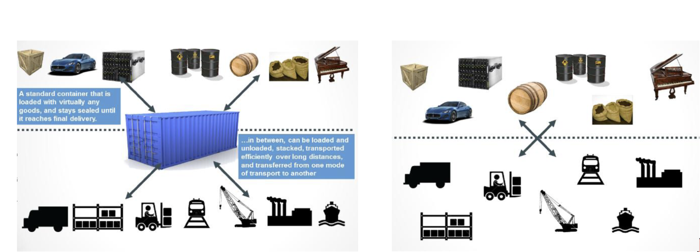
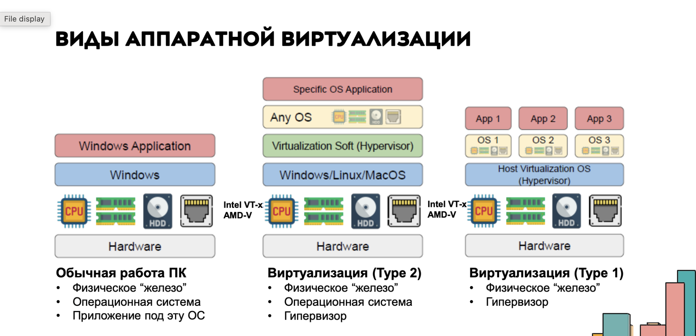
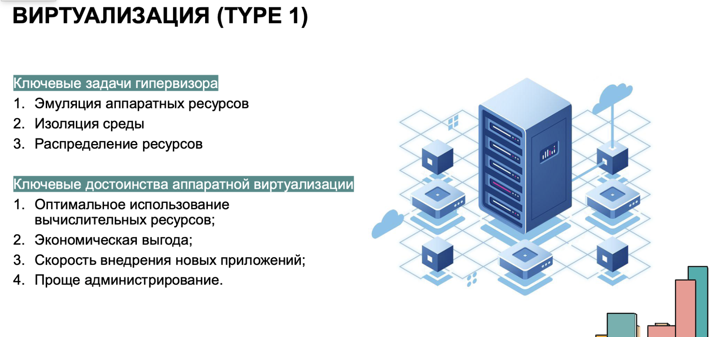
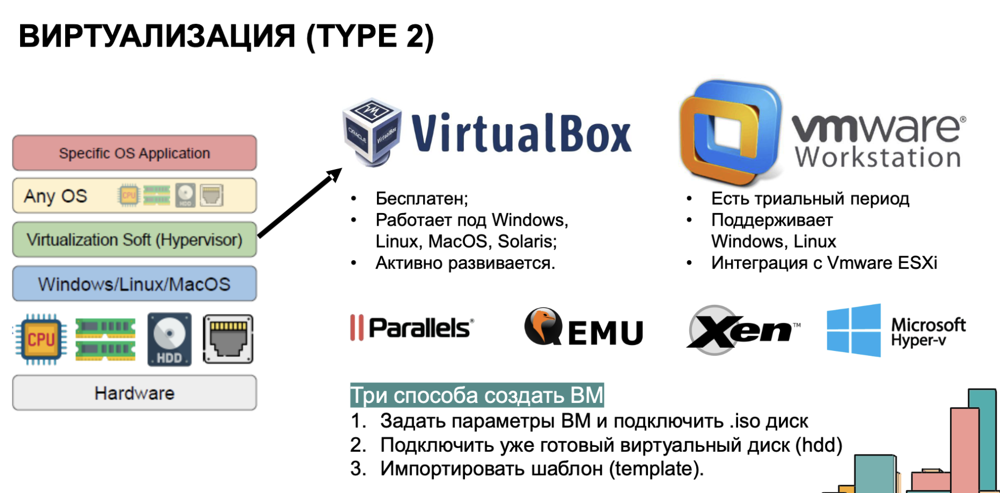
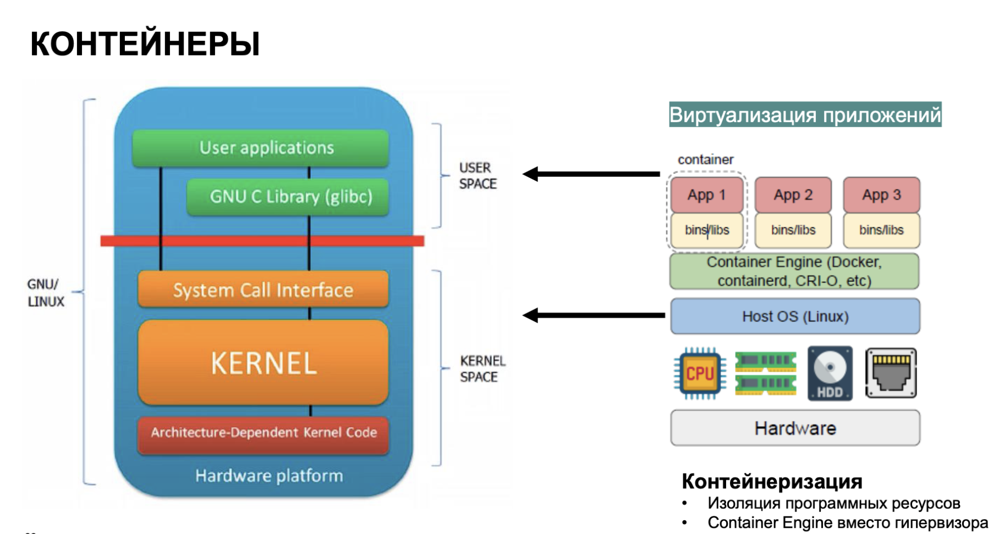
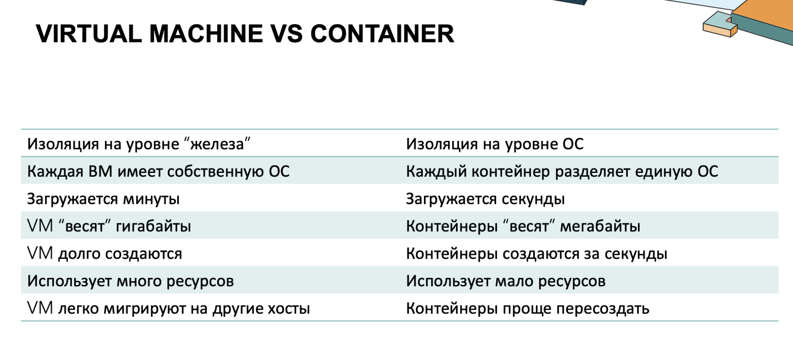
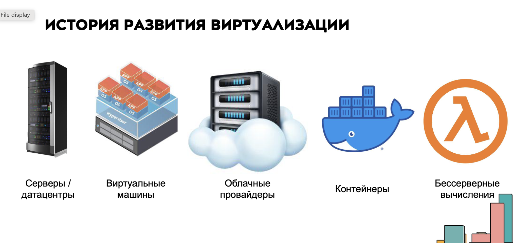
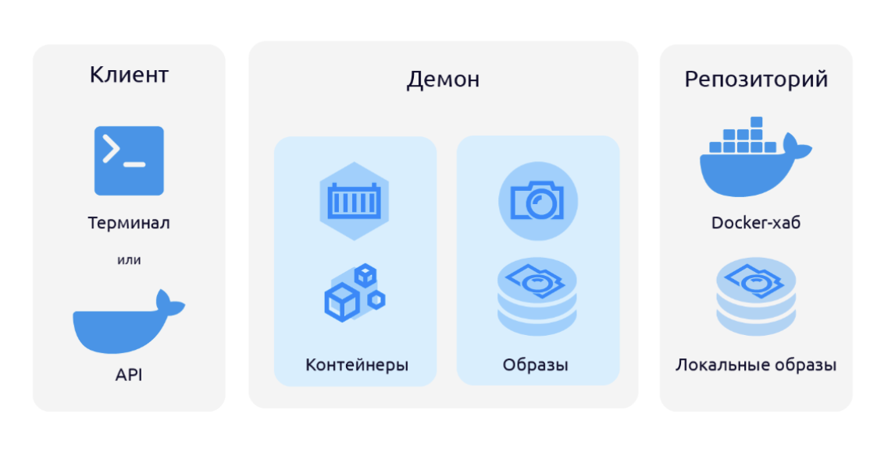
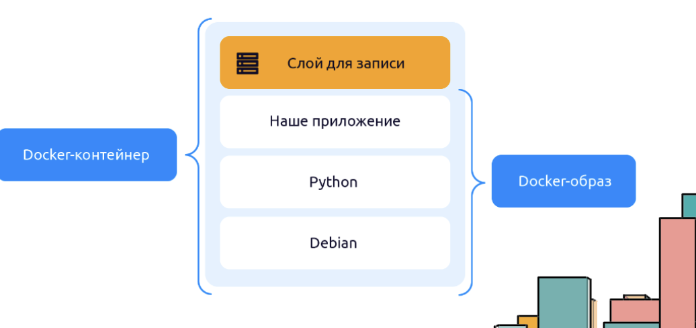
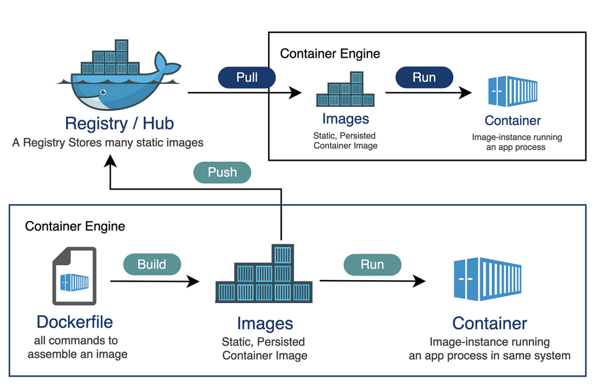

## Docker

#### Горбачева Маргарита Валерьевна | 24КНТ4


**Docker** - это средство или система упаковки, доставки и запуска приложений. Он помогает осуществить изолированный запуск приложений в контейнерах; упрощает разработку, тестирование и деплой; отсутствие необходимости конфигурировать среду для запуска (она поставляется вместе с приложением в контейнере); упрощает масштабируемость приложений и управление их работой с помощь/ систем оркестрации контейнеров.

(Это как полуфабрикаты из супермаркета, только с программами.)



Появление докера сильно упростило процесс доставки и запука приложений у конечных пользователей.


**Виртуализация** 

До появления Docker основным способом изоляции приложений были виртуальные машины. 
Каждая виртуальная машина имитировала полноценный компьютер: со своей ОС, драйверами и файловой системой. Для управления ими использовался гипервизор - программный слой, который распределяет ресурсы хоста между несколькими виртуальными машинами. То есть виртуализация - выделение ресурсов в изолированную среду. 

Если бы не было виртуализации, пришлось бы покупать новые серверы под каждый новый сервис, это стоило бы и повышенного электропотребления, пришлось бы конструировать сложную сетевую архитектуру, где была бы сложная и дорогая система резервного копирования и выше вероятность в отказе оборудования. Поэтому на помощь пришли системы вирутализации.














Docker работает иначе. Он использует подход OS-level virtualization - контейнеризацию на уровне операционной системы. Вместо того чтобы поднимать отдельную ОС под каждое приложение, Docker создаёт изолированные контейнеры, которые делят ядро хостовой системы, но имеют собственное пространство процессов, файлов и сетей.

При разработке приложений часто возникает одна и та же проблема: у каждого разработчика своё окружение. Разные версии библиотек, интерпретаторов, системных зависимостей. В результате код, который стабильно работает на одном компьютере, может не запуститься на другом.
Docker решает эту проблему - он создаёт единый и воспроизводимый способ запускать приложения.

**Основная идея**: Docker - это платформа контейнеризации. Она позволяет упаковать приложение вместе со всеми зависимостями в изолированную среду - контейнер. 
Такой контейнер можно запустить где угодно: на локальной машине, сервере или в облаке, и результат всегда будет одинаковым.

Допустим, мы хотим запустить интернет-магазин на готовой системе управления, а если торговля пойдёт - запустить ещё несколько подобных магазинов. В магазине нам нужен движок, интерпретатор PHP, система работы с БД PHPMyAdmin и FTP-сервер для работы с файлами.

Можно настроить все эти сервисы вручную:
1) Установить PHP и настроить его для наших задач.
2) Установить MySQL и PHPMyAdmin и т.д. и т.п.

В результате мы всё сделаем как нужно, но потратим на это много времени. Если через месяц нам нужно будет запустить ещё три таких же магазина, то придётся делать всё то же самое, но уже на других серверах. Кажется, что это можно поручить машине.

Ручная установка всего на сервер - это как приготовить пиццу дома полностью самому: замесить тесто, купить и нарезать овощи и колбасу и так далее. В результате мы получим вкусное блюдо, но потратим на приготовление много времени.

Docker - автоматизация рутинной работы.

Если мы заранее знаем, что некоторые наши действия могут повторяться, то идеальным выходом из ситуации будет автоматизация. Мы заранее прописываем все действия в виде скрипта, а потом просто запускаем этот скрипт. Похоже на рецепт пиццы.

### Компоненты экосистемы Docker

Следуя специальным инструкциям в конфигурационных файлах, докер собирает все необходимое для зпауска приложения в одно место - образ. **Docker-образ** можно сравнить с CD-диском, с которого в будущем будет установлен запущен некий софт. 
А вот **контейнер** - это запущенная копия образа.



В основе Docker лежит Docker Engine - система, которая управляет контейнерами, образами, сетями и томами. Когда вы вводите команду вроде ```docker run```, клиент CLI отправляет запрос в dockerd (daemon) через сокет. Фоновый процесс получает эту команду, проверяет наличие нужного образа, готовит окружение, настраивает сеть, монтирует тома и запускает контейнер. Вся работа по созданию и управлению контейнерами происходит именно внутри демона (Docker Daemon) - он оркестрирует остальные части системы.

### Системные компоненты

* Docker-host - это просто компьюьер или виртуальный сервер, на котором установлен докер.
* Docker daemon - центральный системный компонент, который управляет еми процессами докера: создание образов, запуск и установка контейнеров, скачивание образов.
* Docker client - это утилита, предоставляющая API к докер-демону. Клиент может быть консольным(*nix-системы) или графическим(Windows).


### Переменные компоненты

**Docker-образ** - это шаблон, из которого создаются Docker-контейнеры. Он хранит в себе все необходимое для запуска приложения, помезенного в контейнер: код, среду выполнения, библиотеки, переменные окружения и другие опции.

В **dockerfile** записываются команды и опции создания образа, а также некоторые настройки будущего контейнера - порты, переменные окружения.

### Что нужно знать о docker-образах

* Docker-образ - шаблон для создания контейнеров.
* В основе любого образа лежит родительский образ. 
* Образ состоит из слоев.
* Каждая команда Dockerfile создает новый слой.
* Образы можно переиспользовать.
* Образы можно загружать в удаленный репо.

### Docker-контейнеры

**Контейнер** - запузенный и изолированный образ о возможностью временного сохранения данных. Данные записываются в специальный слой "сверху" контейнера и при удалении контейнера данные также удаляются. При сборке Docker складывает слои в определённом порядке и объединяет их в единую файловую систему с помощью драйвера overlay2. Он накладывает слои друг на друга так, что контейнер видит их как один диск, хотя физически это отдельные части.



### Повторим, что такое Docker

Docker - система упаковки, доставки и развертывания приложений. Docker состоит из следующих компонентов:
* Docker host
* Docker daemon
* Docker client
* Docker compose
Центральный системный элемент инфраструктуры - Docker daemon. Именно он создает образы и контейнеры, следит за их состоянием, управляет сетевым окружением контейнеров и работает с локальным и удаленным репозиторием. 
Двумя основными сущностями, которыми оперирует docker, являются образ и контейнер.

Помимо оьразов и контейнеров есть еще и сеть, и тома.
**Том (Volume)** - это место для данных, которые должны сохраняться между перезапусками. Тома подключаются к контейнерам как внешние диски: всё, что записано в них, остаётся даже после удаления контейнера.
Так обычно хранят базы данных, логи и другие важные файлы.

**Сеть (Network)** - отвечает за взаимодействие контейнеров между собой и с внешним миром. Docker автоматически создаёт bridge-сеть, где каждый контейнер получает свой IP-адрес.
Можно объединять контейнеры в собственные сети или, наоборот, изолировать их, если требуется полная автономность.

### Жизненный цикл docker-образа


### Сеть контейнеров
При запуске Docker автоматически подключает контейнер к внутренней виртуальной сети. По умолчанию используется bridge-сеть - изолированная среда, где каждый контейнер получает свой IP-адрес и может обмениваться данными с другими участниками этой сети.
С точки зрения контейнера это выглядит как отдельная машина с полноценным сетевым интерфейсом, маршрутизацией и DNS.
Bridge-сеть создаётся на стороне хоста: Docker поднимает виртуальный интерфейс, назначает подсеть и настраивает NAT (Network Address Translation (NAT) is the underlying engine that connects isolated containers to the outside world), чтобы контейнеры могли выходить в интернет. 

### Как контейнеры находят друг друга внутри сети?
В пользовательских bridge-сетях Docker поднимает встроенный DNS-сервер. Благодаря этому контейнеры могут обращаться друг к другу по имени, а не по IP-адресу.
Например, если в одной сети запущены два контейнера - web и db, - то приложение внутри web может подключиться к базе по адресу db:5432. Docker сам сопоставит имя контейнера с его текущим IP-адресом, так что вручную настраивать адреса не нужно.

### Логи и события
Все процессы внутри контейнера работают так же, как в обычной системе Linux. Всё, что они выводят в стандартные потоки (stdout и stderr), Docker перенаправляет в драйвер логирования - систему, которая отвечает за сбор и хранение логов.
По умолчанию используется драйвер json-file: логи записываются на хосте в файл в формате JSON. Это удобно для локальной отладки и просмотра через команду docker logs.
В продакшене часто выбирают другие драйверы:
1) journald - чтобы писать логи в системный журнал Linux;
2) syslog - для отправки логов на внешний сервер;
3) fluentd - для сбора и анализа данных в распределённых системах.
Для каждого контейнера можно задать свои параметры: выбрать драйвер, ограничить размер файлов, включить ротацию (автоматическую замену старых логов новыми).
Помимо логов Docker фиксирует события - всё, что происходит в системе: запуск или остановка контейнера, создание или удаление, загрузка образа, подключение тома. Эти данные доступны через API или команду docker events.
На практике события используют для мониторинга и интеграций: например, CI/CD-система может автоматически запускать тесты при создании контейнера или отправлять уведомления о сбоях. Благодаря этой системе Docker остаётся прозрачным: всегда можно узнать, что происходит с каждым контейнером и когда именно, не заходя внутрь вручную.

### Docker compose

Когда проект растёт, одного контейнера уже не хватает. Помимо основного приложения появляются база данных, кэш, очередь сообщений. Все они работают в отдельных контейнерах, и запускать их вручную неудобно.

Docker Compose позволяет описать все нужные контейнеры и их настройки в одном файле - docker-compose.yml. После этого весь проект можно запустить одной командой.

Docker composse предназначен для создания и запуска одного или нескольких контейнеров. Есть еще одна интересная, но страшная вещь - Kubernetes. Так вот вотличие от Docker compose в том. что Kuberntes больше служит платформой для создания сети, в котрой мы можем оркестрировать контейнеры. Docker compose может настроить все сервисные зависимости приложения, чтоб приступить к работе. Мощный инструмент для местного развития. 

```services:
  web:
    build: .
    ports:
      - "8000:8000"

  redis:
    image: redis:alpine
```
* services - список контейнеров, которые нужно запустить;
* web - наш основной сервис, собирается из текущей директории (build: .) и открывает порт 8000;
* redis - дополнительный контейнер, разворачивается из готового образа redis:alpine.

Сохраним файл и выполним команду:
```docker compose up ```

Docker соберёт образы, создаст контейнеры, подключит сеть и запустит всё вместе.

Чтобы остановить проект, выполним команду: 
```docker compose down```

### Полезные команды docker
```
docker run - создать и запустить контейнер
docker ps - список запущенных контейнеров
docker stop <name/id> / docker start <name/id> - остановить или запустить контейнер
docker rm <name> - удалить установленный контейнер
docker logs -f <name> - смотреть логи контейнера в реальном времени
docker system prune - удалить все остановленные контейнеры, неиспользуемые сети и «висячие» (dangling) образы. Безопасный вариант для регулярной уборки
docker system prune -a  - то же самое, но удаляет все образы, не связанные с запущенными контейнерами
docker volume prune - удалить тома
docker compose up
docker compose down
```

### Пример простого Dockerfile:
```
FROM python:3.11-slim
WORKDIR /app
COPY . .
RUN pip install -r requirements.txt
CMD ["python", "app.py"]
```

Что здесь происходит:

FROM - задает базовый образ, от которого наследуется наш;

WORKDIR - создает рабочую директорию внутри контейнера;

COPY - копирует файлы проекта с компьютера в образ;

RUN - выполняет команды при сборке (например, установка библиотек);

CMD - указывает, что делать при запуске контейнера.

Важно: когда контейнер запускается, процессы внутри него по умолчанию работают с правами root. 

### Практический пример

Разберём, как создать и запустить свой первый контейнер.

Сначала в папке проекта должны лежать три файла:
```
myapp/
├─ app.py
├─ requirements.txt
└─ Dockerfile
```
В `app.py` напишем простейшее приложение на Python. Оно будет показывать строку "Hello from Docker!", когда вы откроете страницу в браузере:
```
from http.server import HTTPServer, BaseHTTPRequestHandler

class Handler(BaseHTTPRequestHandler):
    def do_GET(self):
        self.send_response(200)
        self.end_headers()
        self.wfile.write(b"Hello from Docker!")

if __name__ == "__main__":
    HTTPServer(("0.0.0.0", 8000), Handler).serve_forever()
```

Файл requirements.txt нужен, чтобы перечислить зависимости проекта. Если их нет, то можно оставить его пустым.

Собираем образ. 

Теперь откроем терминал, перейдем в папку myapp и выполните:
`docker build -t myapp .`

Флаг -t задаёт имя образа, а точка в конце указывает путь к контексту сборки - папке, где лежит Dockerfile и файлы проекта. После выполнения команды Docker по шагам прочитает Dockerfile и соберёт новый образ.

`docker run -d -p 8000:8000 myapp`

флаг -d запускает контейнер в фоновом режиме (detached);

-p 8080:80 пробрасывает порт 80 внутри контейнера на порт 8080 нашей машины.

Docker создаст контейнер и запустит внутри него ваш app.py.
Откроем http://localhost:8000, и увидим сообщение: "Hello from Docker!".