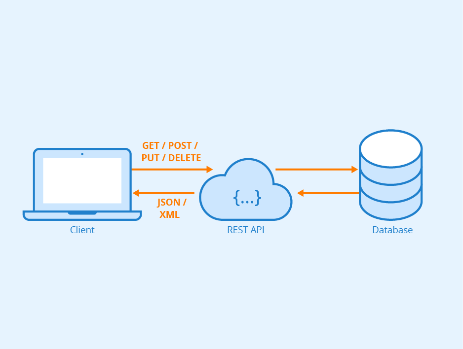
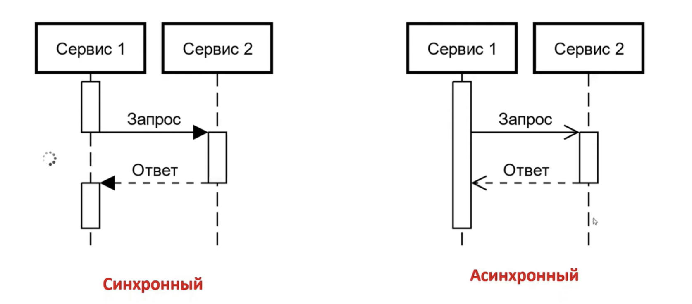
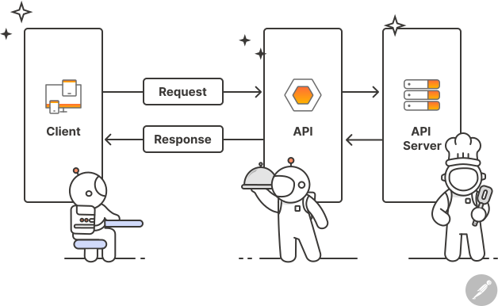
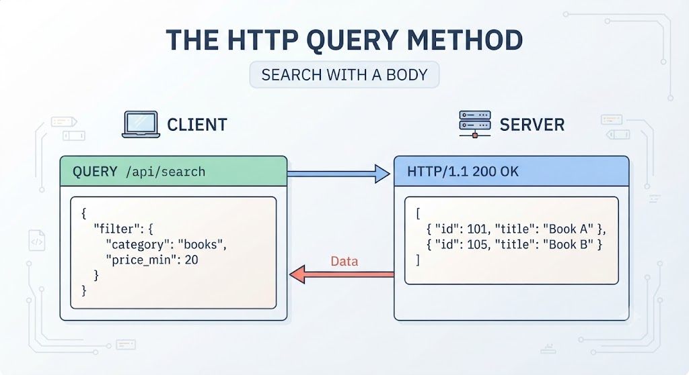
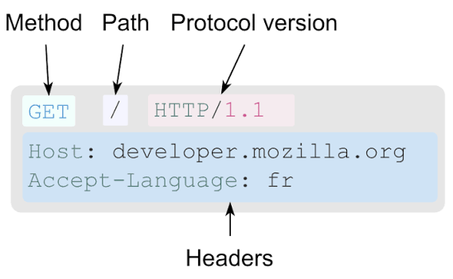
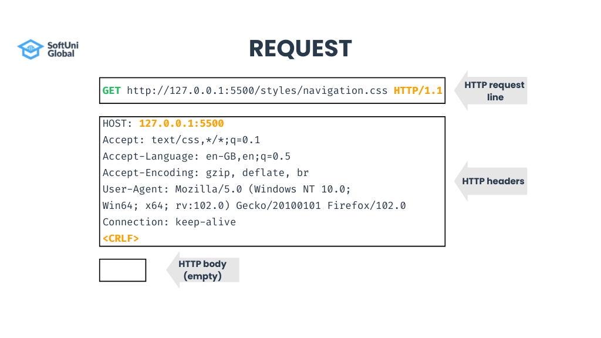
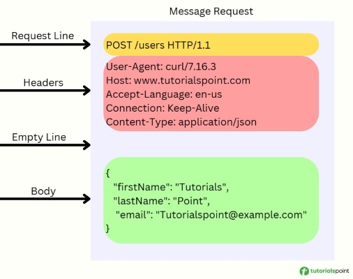
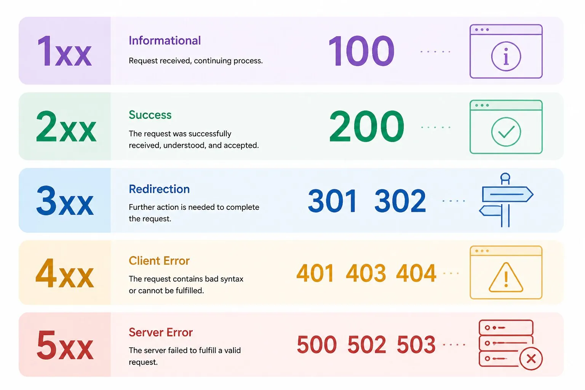
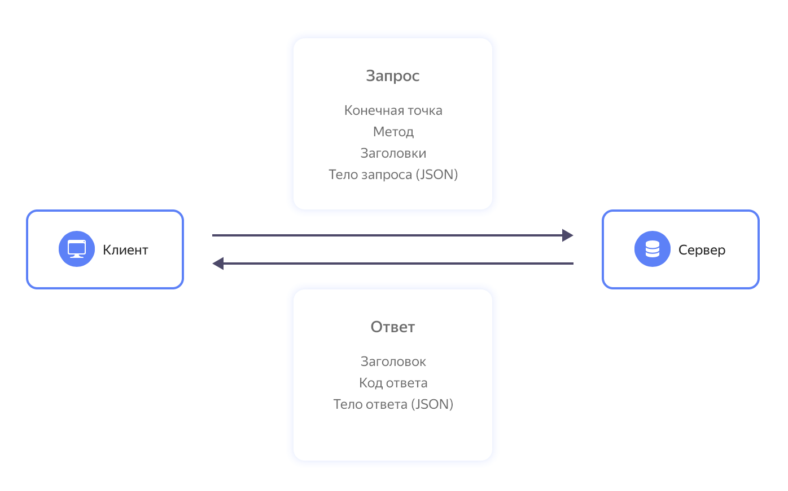

## Клиент-серверное и межсервисное взаимодействие | REST API

#### Горбачева Маргарита Валерьевна | 24КНТ4

### Синхронное и асинхронное взаимодействие



**Синхронное взаимодействие** - это такое взаимодействие, при котором семантика сервиса А такова, что он не может продолжить выполнение запроса, если не получил ответ от сервиса Б.

Наример: 
* сервис "заказ" не может продолжить свою работу, пока не убедится, что пользователь обладает необхоимыми правами для удаления заказа.
* сервис "оформление заказа" не может закончить свою работу, пока не придет подтверждение биллинга об оплате.

P.S. это еще называется **функциональной зависимостью**, когда результаты одной функции необходимы для работы другой.

**Асинхронное взаимодействие** - это такое взиамодействие, при котром сервис А в соответствии с семантикой предметной области может продолжить выполнение, не дожидаясь ответа от Б.

Наример: 
* Сервису "регистраций" достаточно сообщить о факте создания нового пользователя, ему не нужен ответ от сервиса нотификаций.
* формирование отчетов налоговой или брокера.



### API

API - Application Programming Interface - описание способов(набор классов, процедур, функций, структур или констант), которыми одна компьютерная программа может взаимодействовать с другой программой. 
! API реализуется с помощью каких-то протоколов обмена. 

Работу API можно сравнить с работой официанта. Клиент делает заказ в ресторане, так же, как пользователь делает запрос к какому-нибудь веб-серверу. API обращается к серверу с запросом и возвращает пользователю необходимую, запрошенную информацию, как и официант возвращается к посетителю с блюдом от повара.



### Протоколы обмена
HTTP, REST API, SOAP, GRAPHQL, WEBSOCKETS, RPC(GRPC, TRPC)

1. HTTP - сетевой протокол прикладного уровня
2. REST API - архитектурный стиль
3. SOAP - протокол обмена структурированными сообщениями
4. GRAPHQL - язык запросов
5. WEBSOCKETS - сетевой протокол
6. RPC(GRPC, TRPC) - удаленный вызов процедур





P.S. еще в HTTP-запросе выделяется тело сообщения(body), но в методе GET тело сообщения всегда пусто.




### Основные методы CRUD(create, read, update, delete)
* GET
* HEAD
* POST
* PUT
* DELETE
* CONNECT
* OPTIONS
* TRACE
* PATCH

GET запрашивает представление ресурса. Запросы с использованием этого метода могут только извлекать данные.

HEAD запрашивает ресурс так же, как и метод GET, но без тела ответа.

POST используется для передачи данных. Часто вызывает изменение состояния на сервере.

PUT заменяет все текущие представления ресурса данными запроса (обновление ресурса).

DELETE удаляет указанный ресурс.

CONNECT устанавливает "туннель" к серверу, определённому по ресурсу.

OPTIONS используется для описания параметров соединения с ресурсом.

TRACE выполняет вызов возвращаемого тестового сообщения с ресурса.

PATCH используется для частичного изменения ресурса.

### Коды сообщений запроса HTTP


[HTTP Cats](https://http.cat)

Это забавный проект, который иллюстрирует стандартные коды состояния протокола HTTP с помощью фотографий котов.

### REST API

Representational State Transfer - передача репрезентативного состояния.

REST API — это не один конкретный протокол взаимодействия, а архитектурный стиль (то есть набор правил для серверного приложения). Он описывает, как разработчику следует спроектировать интерфейс для взаимодействия своего приложения с другими. Если продолжить аналогию с естественным языком, то REST API описывает грамматику.

Для доступа клиентских приложений к данным, хранящимся на сервере, в REST API используются такие методы как POST, GET, PUT, PATCH и DELETE. При этом обмен сообщениями осуществляется обычно по протоколу HTTP(S).

Главная особенность REST API - обмен сообщениями без сохранения состояния. Каждое сообщение самодостаточное и содержит всю информацию, необходимую для его обработки. Сервер не хранит результаты предыдущих сессий с клиентскими приложениями. Это обеспечивает гибкость и масштабируемость серверной части, позволяет поддерживать асинхронные взаимодействия и реализовывать алгоритмы обработки любой сложности. Кроме того, такой формат взаимодействия является универсальным -  он не зависит от технологий, используемых на клиенте и на сервере, и не привязывает разработчиков к определенному провайдеру.

Из-за того, что приходится каждый раз заново передавать все данные для обработки запроса, объем сообщений увеличивается. Чтобы сохранить при этом высокую скорость обмена, данные передаются в максимально сжатом формате. Чаще всего REST API использует формат JSON, более лаконичный, чем XML.



Клиент отправляет запрос на сервер. Сервер аутентифицирует клиента и проверяет его права, затем обрабатывает запрос и возвращает ответ клиенту.

#### Методы

Как правило, для взаимодействия между клиентом и сервером достаточно пяти методов:

GET - получение информации об объекте (ресурсе).

POST - создание нового объекта (ресурса).

PUT - полная замена объекта (ресурса) на обновленную версию.

PATCH - частичное изменение объекта (ресурса).

DELETE - удаление информации об объекте (ресурсе).

Реже используются методы HEAD (для получения заголовка объекта или ресурса) и OPTIONS (возвращает список доступных методов).

#### Пример

Допустим, наш интернет-магазин работает со сторонней службой доставки и обращается к ее серверу с помощью методов REST API.

* Чтобы передать в службу доставки информацию о новом заказе, отправляется запрос с методом POST.
* Когда служба доставки соберет все необходимые товары, передаст курьеру, обозначит примерное время доставки и обновит статус заказа - данные на сервер отправятся методом PUT.
* Если служба доставки позволяет отслеживать маршрут движения курьера с заказом на карте, то координаты заказа обновляются методом PATCH.
* Если покупатель хочет проверить текущий статус заказа в личном кабинете, интернет-магазин отправляет на сервер службы доставки запрос GET.
* Если покупатель передумал сразу после отправки заказа, он может отменить его, отправив запрос DELETE - в этом случае в базе данных не сохранится никакой информации о несостоявшейся покупке. Но если интернет-магазин хочет хранить историю заказов, даже отмененных, он будет использовать метод POST.

#### Структура запроса

Запрос REST API от клиента к серверу всегда состоит из следующих элементов:

* **Конечная точка (endpoint)** - адрес, по которому отправляется запрос.

    Один и тот же объект (ресурс) может иметь несколько конечных точек.
Например, чтобы отправить запрос на сервер службы доставки Best Delivery, может использоваться конечная точка ```best-delivery.com/orders```. Чтобы посмотреть список заказов, можно использовать конечную точку ```best-delivery.com/orders/list```, а чтобы разместить новый заказ - ```best-delivery.com/orders/create```.

* **Параметры** - делятся на параметры пути и параметры запроса.

    Например, в запросе ```best-delivery.com/orders/{userId}/list {userId}``` - это параметр пути. Вместо ```{userId}``` нужно подставить идентификатор конкретного пользователя, тогда запрос вернет список заказов этого пользователя.
В запросе ```best-delivery.com/orders/list?orderId=123456 orderId``` - это параметр запроса. Такой запрос вернет информацию о конкретном заказе.
В одном запросе может быть несколько параметров пути и несколько параметров запроса. Параметры запроса соединяются между собой символом ```&```. Например, запрос ```best-delivery.com/orders/shop/{shopId}/users/{userId}/list?top=10&sortDate=DESC``` вернет список заказов в магазине ```{shopId}``` для пользователя ```{userId}```, причем список будет содержать только 10 последних заказов, т.к. он отсортирован по убыванию даты заказа.

* **Заголовки (headers)** - в заголовках определяется формат передаваемых данных, спецификация и версия протокола обмена и другая информация, необходимая для корректной обработки запроса.

    Если для выполнения запроса требуется аутентификация, в заголовке передаются сведения о пользователе - логин, токен и т.п. Заголовки не отображаются в пути запроса.
Тело запроса (body) - данные для обработки, как правило в формате JSON.

    Например, запрос для службы доставки может содержать номер заказа, адрес, телефон для связи и интервал доставки, примерно так:
```{“orderId”:123456, “address”:”119021, Москва, ул. Льва Толстого, 16”, “phone”:”+74957397000”, “time_interval”:”9:00-11:00”}.```

#### Структура ответа

После выполнения REST API запроса сервер вернет клиентскому приложению ответ. Он включает код ответа, заголовки и тело ответа.

* Как и в запросе, заголовки в ответе также определяют формат передаваемых данных, спецификацию и версию протокола обмена, и другие сведения, которые помогут клиентскому приложению правильно прочитать и понять ответ.
* Тело ответа — это информация, которую запрашивал клиент. Ответ тоже чаще всего передается в формате JSON. Но тело ответа может быть и пустым.
* Код ответа — это признак успешности выполнения запроса. Для унификации используются стандартные коды ответа. Они представляют собой трехзначные числа. Ответы, начинающиеся с цифры 1, обозначаются 1xx, и т.п.

Ответы вида 1хх — информационные.

Ответы вида 2хх говорят об успешном выполнении запроса. Например:

    200 – ОК. Если клиентом были запрошены какие-либо данные, то они находятся в заголовке или теле сообщения.

    201 – OK. Создан новый ресурс.

Ответы вида 3xx обозначают перенаправление или необходимость уточнения. Например:

    300 — на отправленный запрос есть несколько вариантов ответа. Чтобы получить нужный вариант, клиент должен уточнить запрос.
    301 — запрашиваемый адрес перемещен.
    307 — запрашиваемый адрес временно перемещен.

Ответы вида 4хх говорят о том, что при выполнении запроса возникла ошибка, и это ошибка на стороне клиента. Например:

    400 – Bad Request. Запрос некорректный.
    401 – Unauthorized. Запрос требует аутентификации пользователя.
    403 – Forbidden. Доступ к сервису запрещен.
    404 – Not found. Ресурс не найден.

Ответы вида 5хх говорят об ошибке на стороне сервера. Например:

    503 — сервис недоступен.
    504 — таймаут (превышено допустимое время обработки запроса).

Как уже говорилось выше, REST API - это архитектурный подход, а не конкретный протокол. Каждое приложение или сервис может иметь свой API, разработанный в соответствии со стандартами и лучшими отраслевыми практиками. Такая свобода обеспечивает большую гибкость и широту возможностей. Но чтобы сторонние разработчики могли воспользоваться разнообразными возможностями вашего сервиса, API должен быть хорошо задокументирован.

Отраслевым стандартом описания REST API является спецификация документирования OpenAPI (ранее она называлась Swagger). В настоящее время используется версия OpenAPI Specification 3.0, а также немного устаревшая, но еще актуальная версия 2.0.